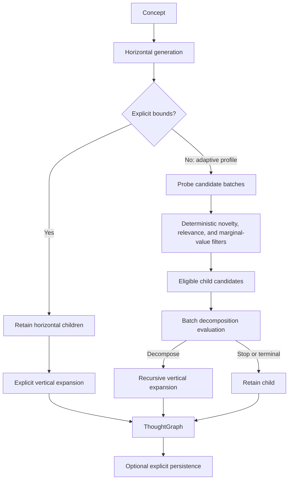

# XF ThoughtGraph

XF ThoughtGraph is a Python library for turning a complex concept into a structured thought graph. It explores the major dimensions of a topic horizontally, then develops selected thoughts vertically into more detailed, ordered, or dependent ideas.

The library exists for cases where a single list of model-generated ideas is too shallow, but an unbounded recursive conversation is too expensive and difficult to control. It combines provider-assisted generation with deterministic filtering, explicit safety limits, and an evaluation step that decides whether another decomposition level is worth the next provider call.

The result is a validated tree of `ThoughtNode` objects in a `ThoughtGraph`. The graph preserves the distinction between sibling exploration and parent-child decomposition; it does not create arbitrary cross-branch edges.

## Local Setup (Clone and Run)

Use this workflow when you want to run the repository's examples or tests from a checkout. It is separate from installing XF ThoughtGraph as a dependency in another Python project.

Prerequisites: Git, Python 3.10 or newer, and [uv](https://docs.astral.sh/uv/).

```bash
git clone https://github.com/xfzhang823/xf-thoughtgraph.git
cd xf-thoughtgraph
uv sync --extra providers --extra dev
```

Configure the API key for the provider you want to call. For example:

```bash
export OPENAI_API_KEY="your-api-key"
```

The other built-in providers use `ANTHROPIC_API_KEY`, `GEMINI_API_KEY`, or `DEEPSEEK_API_KEY`. Then run a minimal live thought-generation request:

```bash
uv run python - <<'PY'
from xf_thoughtgraph import generate_thought_graph

graph = generate_thought_graph(
    "Design a reliable data ingestion platform",
    provider="openai",
    horizontal=2,
    vertical=1,
)
print(graph.model_dump_json(indent=2))
PY
```

Verify the installation with the repository's test suite:

```bash
uv run pytest
```

These commands install and run the checkout itself; they do not assume that `xf-thoughtgraph` is available on PyPI. If you are adding the library to another Python project, use that project's dependency workflow with a local path or the repository's Git URL instead of cloning this repository to run its tests.

## How It Works

The engine starts with a concept and chooses one of two generation modes. Both modes use the same tree-shaped output and vertical progression semantics, but they differ in how much control the caller supplies over breadth and depth.



Horizontal generation asks for distinct major dimensions of the concept at the same abstraction level. It is not intended to mix categories with implementation steps, examples, or fine-grained details. Vertical generation expands one retained thought in the context of its parent and ancestors. The selected `ProgressionType` tells the provider how those children should progress—for example, from simple to complex or through prerequisites and dependencies.

Provider calls supply semantic proposals. Python code validates their structured output, removes repeated or unsuitable candidates, enforces budgets, and builds the graph.

## Quick Start

From a local checkout, follow [Local Setup (Clone and Run)](#local-setup-clone-and-run). If you are adding the library to another project, use that project's dependency workflow with the repository URL or a local path; this README does not assume a PyPI publication.

```bash
uv add "xf-thoughtgraph @ git+https://github.com/xfzhang823/xf-thoughtgraph.git"
export OPENAI_API_KEY="..."
```

```python
from xf_thoughtgraph import ProgressionType, generate_thought_graph

graph = generate_thought_graph(
    "Design a reliable data ingestion platform",
    provider="openai",
    exploration="balanced",
    progression_type=ProgressionType.PREREQUISITE_DEPENDENCY,
)

print(graph.concept)
print(graph.model_dump_json(indent=2))
```

The convenience function requires a provider name or an injected provider. Named providers use their configured default model unless `model` is supplied. The example makes live provider calls; the repository's examples use fake providers for offline behavior checks.

For direct control, construct the engine and provide explicit horizontal and vertical bounds:

```python
from xf_thoughtgraph import ThoughtGraphEngine

engine = ThoughtGraphEngine(provider="openai")
graph = engine.generate_thought_graph(
    topic="Design a reliable data ingestion platform",
    horizontal=4,
    vertical=3,
)
```

## Generation Modes

### Adaptive generation

Omit both bounds and select an exploration profile (`"focused"`, `"balanced"`, or `"rich"`). The engine probes horizontal candidates in small batches and retains only meaningful, sufficiently distinct thoughts. It then expands retained nodes as needed.

Profiles change evidence thresholds and filtering strictness; they do not translate into fixed graph sizes. Adaptive generation is bounded by provider-call, node, expansion, candidate, and depth limits. If a limit is reached, the engine returns the valid partial graph produced so far and records the decision in its adaptive trace.

If no mode is specified, the public convenience API uses the `"balanced"` profile. Adaptive and explicit bounds are mutually exclusive: choose a profile or provide `horizontal` and `vertical`, not both.

### Explicit generation

Supply `horizontal` and `vertical` to request a predictable bounded traversal:

```python
graph = engine.generate_thought_graph(
    topic="Plan a product launch",
    horizontal=5,
    vertical=2,
    progression_type=ProgressionType.CHRONOLOGICAL,
)
```

`horizontal` controls the retained root-level alternatives. `vertical` controls the maximum number of generated child levels beneath the root. A vertical value of `1` therefore returns the root and its horizontal children without expanding those children; the returned metadata still reports the requested value. Explicit mode uses a fixed provider request size for each vertical expansion; it does not infer vertical child count from the horizontal bound.

The returned `ThoughtGraph` includes `depth` and `breadth` metadata describing the requested/output shape. These are output fields, not deprecated generation parameters.

## Evaluation and Continuation

Adaptive continuation has two distinct stages.

First, deterministic filters remove candidates that are repetitive, insufficiently related to the root or ancestor path, unlikely to add marginal value, or recognizable as natural endpoints. These checks use normalized tokens, overlap signals, path context, and profile thresholds. They do not call an LLM.

Second, the active decomposition evaluation agent receives the eligible candidates for a parent as a batch. Its narrow question is whether another vertical decomposition step is worth the next provider call. It is not asked to generate children, rank general quality, replace relevance filtering, or enforce a fixed graph width or depth. The agent returns a decision for each stable candidate identifier, with a reason that is retained in the evaluation result.

The evaluator is therefore not invoked for every thought. Only candidates surviving the deterministic filters reach it. A positive decision permits recursive expansion; a negative decision retains the candidate as a terminal branch. Provider failures or malformed evaluation responses are handled at the adaptive boundary, while safety budgets still prevent unbounded growth.

## Installation and Providers

XF ThoughtGraph supports Python 3.10 and newer. The core package depends on Pydantic for validated models. Provider SDKs are optional:

```bash
# From a checkout:
uv sync --extra providers
# From another project, use the repository URL or a local path as its dependency source.
```

The `providers` extra installs the bundled OpenAI, Anthropic, Google Gemini, and DeepSeek integrations. Their SDKs are imported lazily, so applications that only use models, injected providers, or test doubles do not need every SDK installed.

The provider boundary is `LLMProvider` for synchronous generation and `AsyncLLMProvider` for asynchronous integrations. The engine's public graph-generation methods are synchronous. Applications may also inject a provider implementation directly rather than selecting a built-in provider by name.

Provider behavior is intentionally not flattened into a single generic adapter. OpenAI and Anthropic use their native SDKs; Gemini and DeepSeek use the shared OpenAI-compatible transport, with DeepSeek-specific thinking controls preserved. Model defaults can be overridden through the provider-specific environment variables or an explicit `model`.

## API Overview

The concept-first API is the main entry point:

```python
from xf_thoughtgraph import ThoughtGraphEngine

engine = ThoughtGraphEngine(provider="openai", model="your-model")

graph = engine.generate_thought_graph(
    topic="Build a secure document-processing workflow",
    exploration="focused",
)
```

The engine also exposes focused operations for applications that need intermediate stages:

- `generate_subtopics(concept, ...)` produces horizontal `str` candidates.
- `expand_subtopic(concept, subtopic, ...)` produces vertical detail for one thought.
- `generate_array_of_thoughts(concept, ...)` returns a validated `ThoughtArray`.
- `generate(request)` and `expand(request)` accept the lower-level generation request models used by the package.
- `expand_all(...)` supports the existing typed idea workflow for callers that need its `IdeaJSONModel` shape.

The top-level `generate_thought_graph(...)` function is a small convenience wrapper for the concept-first engine API. Detailed signatures and model contracts are maintained in [`docs/public_api.md`](docs/public_api.md).

## Output Models and Persistence

Graph output is represented by Pydantic models:

- `Thought` contains a non-empty name and an optional description.
- `ThoughtNode` extends `Thought` with a list of child nodes.
- `ThoughtGraph` contains the original concept, the root node, and depth/breadth output metadata.
- `ThoughtArray` represents a concept and a flat list of validated thoughts.

`ProgressionType` affects the intended order or relationship among vertical children. Its values are `IMPLEMENTATION_STEPS`, `SIMPLE_TO_COMPLEX`, `CHRONOLOGICAL`, `PROBLEM_SOLUTION`, and `PREREQUISITE_DEPENDENCY`. It does not create cross-branch graph edges; relationships are represented by the parent-child tree and the generated text.

Persistence is explicit. `MemoryRepository` stores deep-copied values in process memory, while `JsonRepository` writes Pydantic-compatible values to validated plain filenames using an atomic replacement. The engine does not save automatically: provide a repository and call `save` when persistence is part of the application workflow.

```python
from xf_thoughtgraph import JsonRepository, ThoughtGraphEngine

repository = JsonRepository("./thoughtgraph-data")
engine = ThoughtGraphEngine(provider="openai", repository=repository)
graph = engine.generate_thought_graph(
    topic="Design a reliable data ingestion platform",
    horizontal=4,
    vertical=2,
)
engine.save("ingestion-platform", graph)
```

## Architecture and Design Boundaries

The package is deliberately small and separated by responsibility:

- `thought_generation` owns horizontal generation, vertical expansion, adaptive policy, safety limits, and graph assembly.
- `reflection` owns the structured continuation-evaluation contract.
- `providers` owns provider factories, SDK adapters, request translation, and provider errors.
- `models` owns Pydantic output and request schemas.
- `storage` owns repository protocols and JSON or in-memory persistence.
- `prompts` contains the current graph-generation and vertical-progression templates.

LLM output is treated as an external, provider-dependent input. Pydantic validation, candidate filtering, graph construction, and safety accounting remain in application code. The package does not promise deterministic LLM output across providers or models. It also does not implicitly make network calls or persistence calls during package import.

## Development and Documentation

Install development dependencies and run the test suite from a checkout:

```bash
uv sync --extra providers --extra dev
uv run pytest
uv run python examples/thought_generation.py
uv build
```

Useful references:

- [Public API](docs/public_api.md) — supported entry points and model contracts.
- [Vertical progression audit](docs/vertical_progression_audit.md) — progression semantics and invariants.
- [Agent policy boundary](docs/agent_policy_boundary.md) — provider and evaluator boundaries.
- [Excluded components](docs/excluded_components.md) — intentionally out-of-scope functionality.
- [Examples](examples/) — provider-injected and behavior-test workflows.

The repository's tests cover graph construction, explicit and adaptive traversal, provider-specific behavior, structured evaluation, persistence, and serialization. Run the full suite after changing prompts, provider adapters, output models, or traversal policies.
